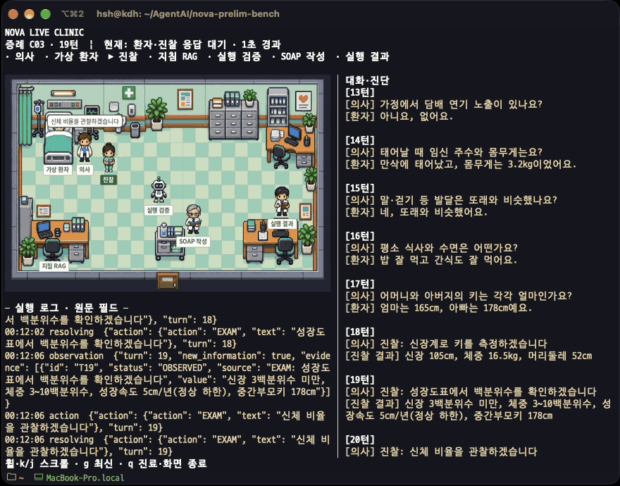
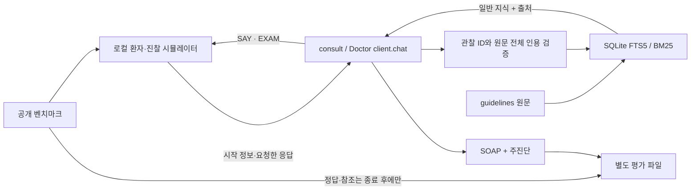

# Medical-AI-Agent

기존 `agentclinic-gpt-oss-toy/`, `nova-starter/`, `nova-devkit/`는 수정하지 않습니다. Python 3.10+ 표준 라이브러리만 사용합니다. 로컬 시뮬레이터는 2026-10-11, 공식 SDK(`nova_sdk.py` 1.0.1)는 2026-10-13 공개 패키지로 갱신했고, starter 에이전트를 예선 실험용으로 확장했습니다.



*C10의 실제 질문·응답 → 진찰 → SOAP 제출 로그를 압축 재생한 예시입니다. 원 실행은 약 19분이며, GIF는 새 추론이나 현재 규칙으로 다시 평가한 결과가 아닙니다.*

## 검증 상태와 현재 방향

2026-10-11 공개 규칙과 코드의 차이를 점검했습니다. **최대 50턴·30분**, 잘못된 SAY/EXAM의 턴 차감, Doctor 호출/토큰 조건을 최신 공개 패키지와 맞췄습니다. [상세 감사 결과](docs/AUDIT.md)에 수정 내역과 미검증 범위를 남겼습니다. 서버 공식 평가까지 통과했다는 뜻은 아닙니다.

이전 C10 로컬 실행은 20분 설정에서 28턴·1,147.9초에 `Graves disease`를 추정해 제출했습니다. 32세, 56→49kg, 7kg 감소를 보존했고 알레르기·흡연 음성을 임의로 추가하지 않았습니다. 그 실행은 이전 규칙 버전의 예시이며, 이번 SDK 갱신 후 새 모델 실행은 하지 않았습니다. 실제 원시 결과는 로컬 `results/`에만 보관합니다.

현재 방향은 **관찰 출처가 남는 SOAP**, **원문 인용을 검증하는 지침 검색**, **진료와 분리된 사후 평가**입니다. 진단·치료의 정확도나 공식 점수를 보장하지 않습니다.

## 먼저 공식 공개 샘플과 병원 화면 확인

```bash
cd nova-prelim-bench
# gpt-oss:20b가 없을 때만 다운로드
ollama pull gpt-oss:20b
python3 develop.py --list
python3 develop.py --case samples/C10
python3 develop.py --case samples/C10 --manual
```

자동 진료를 실행하면 기존 AgentClinic에서 가져온 병원 화면이 `http://127.0.0.1:8768/`에 열립니다. 이전 프로젝트의 8767 포트와 구분됩니다. `--no-browser`는 자동 열기를 생략하고 이벤트 파일은 계속 저장합니다. 화면만 켜려면 `python3 live.py serve --port 8768`을 실행하세요. `bench.py run`도 같은 화면에 연결됩니다. 한 화면은 가장 최근 실행을 따라가므로 동시에 여러 진료를 실행하지 않는 편이 좋습니다.

첫 확인을 빠르게 하려면 `python3 develop.py --case samples/C10 --max-turns 8`을 씁니다. 기본 명령은 최대 50턴/30분입니다. RAG 검색 → 실제 질문·응답 → 진찰 → SOAP 작성이 표시됩니다. 모니터는 읽기 전용이며, 수동 진료는 터미널에서 `s 질문`, `e 진찰`, `q`로 진행합니다. `q`만 입력하면 진단을 제출하지 않고 대화만 저장합니다.

샘플 실행은 최신 공식 `nova-devkit`의 가상 환자/진찰 동작에 로컬 중복 요청 방지 및 예선 제출 검증을 추가합니다. 이 시뮬레이터는 대본에 없는 일부 내용을 정상 범위로 보충할 수 있으므로 엄격한 벤치마크 시뮬레이터의 미확인 반환과 다릅니다. 화면의 OBSERVED는 시뮬레이터에서 받은 응답을 뜻합니다. `samples/C10/model_record.md`는 작성 예시이며 공식 채점 정답이 아닙니다.

결과는 `results/C10-<시각>/`의 `record.md`, `record.json`, `transcript.json`, `retrievals.json`, `grounding.json`, `events.jsonl`, `summary.json`에 저장됩니다. `events.jsonl`은 실시간 화면에 사용한 실제 이벤트입니다. 중단한 실행에서는 `record.md`가 아직 없을 수 있습니다.

## 바로 실행

이 폴더에서 실행합니다. 모델 준비는 별도이며 현재 로컬에 설치된 Ollama `gpt-oss:20b`를 기본으로 사용합니다.

```bash
python3 bench.py check
python3 bench.py search 'diplopia ptosis muscle weakness'

# AgentClinic 진료: RAG 사용, 최대 50턴/30분, 기본 한 증례
python3 bench.py run --dataset agentclinic --limit 1

# 짧은 연결 점검: 충분한 임상 평가가 아님
python3 bench.py run --dataset agentclinic --limit 1 --max-turns 6

# DDXPlus: 압축 파일에서 선택한 행만 읽음
python3 bench.py run --dataset ddxplus --split validate --limit 1

# ACI-Bench: 이미 주어진 대화 → 영어 SOAP, 별도 기록 작성 과제
python3 bench.py run --dataset aci --split valid --limit 1

# 출처를 제외한 같은 코드로 RAG 미사용 비교
python3 bench.py run --dataset agentclinic --offset 0 --limit 1 --no-rag
```

다른 위치의 데이터에는 `--data-root /path/to/nova-benchmarks-2026`을 씁니다. `--offset`은 0부터 시작합니다. 기본 한 증례씩 실행하며 전체 데이터의 모델 추론을 자동으로 시작하지 않습니다. 큰 배치는 `--limit`으로 명시합니다. 오류가 난 증례도 로그를 저장하고 다음 증례를 진행하며, 하나라도 실패하면 종료 코드 1을 반환합니다. Ctrl+C는 현재 증례의 중간 결과를 저장하고 중단합니다.

모델 연결:

```bash
export NOVA_LOCAL_DOCTOR_URL=http://localhost:11434/v1
export NOVA_LOCAL_DOCTOR_MODEL=gpt-oss:20b
# SIM 미설정 시 Doctor와 같은 모델. 별도 가상 환자/진찰 판정 모델도 지정 가능.
# export NOVA_LOCAL_SIM_URL=...
# export NOVA_LOCAL_SIM_MODEL=...
# export NOVA_LOCAL_SIM_KEY=...
```

로컬 Ollama 실행에는 NOVA 개발 키가 필요하지 않습니다. 외부 모델 주소를 지정하면 그 공급자의 비용이 발생할 수 있습니다. 키는 파일이나 제출 ZIP에 넣지 않습니다.

## 적용한 예선 조건

- 같은 `prepare()` → `consult(client, state)`가 로컬과 공식 SDK에서 동작합니다.
- SAY/EXAM은 공백 포함 NFC 30자 이하, 최대 50턴. 잘못 보낸 EXAM 등도 1턴을 사용하고, 모델 쪽 응답 실패는 차감하지 않습니다. SDK가 보내기 전에 차단한 입력은 서버에 도달하지 않습니다. TEST는 실행기에서 거부합니다.
- DIAGNOSE는 0턴이며 50턴 이후에도 마감 전 제출할 수 있습니다.
- SOAP 15칸 + 주진단 하나. 예선 `O.tests`는 비우고 검사 계획은 `P.tests`에 씁니다.
- 모든 Doctor 추론과 RAG 검색어 작성은 `client.chat()`을 사용합니다. 공식 평가에서는 지정 Doctor API(2026-10-13부터 `openai/gpt-6-luna`), 로컬에서는 선택한 모델입니다. 이 문서의 로컬 실행 예시는 이전 기본값인 Ollama `gpt-oss:20b` 기준이며, `gpt-6-luna`로의 변경 후에는 모델 실행 결과를 다시 확인하지 않았습니다.
- 진료 30분, 기록 작성 여유 3분. 로컬 준비/색인은 진료 시계 시작 전에 수행합니다.
- 정규화한 동일 행동의 반복은 실행 전에 차단합니다. 의미가 같은 다른 표현까지 완전히 차단하는 것은 아닙니다.
- 일시 오류로 행동을 재시도할 때 같은 request_id를 유지합니다. 로컬 실행기도 성공한 요청과 턴을 차감한 거절을 중복 실행하지 않습니다. 모델의 무효 응답은 새 ID로 재시도합니다.
- Doctor에는 시작 정보·획득한 응답·검색 지침만 제공합니다. 정답/미공개 검사 결과/참조 기록은 평가 단계에만 보관합니다.
- 지침은 일반 지식으로 구분하며 환자 S/O의 관찰 사실로 복사하지 않도록 지시합니다. LLM의 완전한 사실 준수를 보증하는 검증기는 아닙니다.

공식 계약: https://nova.snubhai.org/docs/

## 세 벤치마크의 서로 다른 역할

| 데이터 | 사용 범위 | 선택/제외 원칙 |
|---|---|---|
| AgentClinic-MedQA | 215개 확장판 증례, 문진·신체진찰·진단·SOAP | 기본 107개는 확장판에 포함되므로 합산하지 않음. Objective_for_Doctor, Correct_Diagnosis, Test_Results는 Doctor와 환자 시뮬레이터에 주지 않음 |
| DDXPlus | train 1,025,602 / validate 132,448 / test 134,529, 문진·진단 | 기존 split 유지. 223개 문항의 B/C/M 값과 기본값을 해석. 질환·감별 정답은 비공개. 진찰 데이터는 없으므로 제공되지 않은 소견을 생성하지 않음 |
| ACI-Bench | train 67 / valid 20 / test1·2·3 각 40, 총 207 대화 | challenge_data만 사용해 ASR판 중복 집계 방지. 정답 note는 생성 후 비교 파일로 저장. 상호작용 예선 시뮬레이션/진단 정확도 평가가 아님 |

DDXPlus 문항 매칭은 LLM이 질문만 보고 문항 ID를 고르고, Python이 그 ID의 실제 값을 반환합니다. 원자료에서 빠진 이진 문항은 데이터셋의 부재 표현에 따라 No, 범주/복수형 문항은 메타데이터 기본값을 사용합니다. 없는 일반 병력 질문은 미확인입니다. AgentClinic 환자는 원자료로 답을 생성하므로 요약/번역 오류 가능성이 있습니다. 진찰은 표의 행 ID를 선택한 뒤 원문 결과를 반환하고, 미제공 결과를 정상으로 보충하지 않습니다.

ACI 대화는 원래의 검사·치료 정보도 포함하므로 이 별도 과제에서는 관찰된 검사 결과를 `O.tests`에 쓸 수 있습니다. 참조 기록과 비교하기 위해 영어로 기록합니다. 예선 진료 경로의 TEST 금지와 빈 `O.tests` 조건은 계속 적용됩니다.

전수 실행 명령(큰 추론 비용/시간에 주의):

```bash
python3 bench.py run --dataset agentclinic --limit 215
python3 bench.py run --dataset ddxplus --split train --limit 1025602
python3 bench.py run --dataset ddxplus --split validate --limit 132448
python3 bench.py run --dataset ddxplus --split test --limit 134529
python3 bench.py run --dataset aci --split train --limit 67
python3 bench.py run --dataset aci --split valid --limit 20
python3 bench.py run --dataset aci --split test1 --limit 40
python3 bench.py run --dataset aci --split test2 --limit 40
python3 bench.py run --dataset aci --split test3 --limit 40
```

튜닝에는 train/validate를 사용하고 test는 최종 평가 전에 고정하세요. AgentClinic은 배포 자체에 train/test split이 없으므로 별도 개발/평가 분할이 필요합니다. 이 코드는 모델 학습이나 프롬프트 최적화를 자동 수행하지 않습니다.

## 관찰에 근거한 예선 SOAP

예선 SOAP의 S/O와 A의 관찰 근거는 `grounding.py`가 시작 정보와 실제 질문·응답을 직접 옮깁니다. 확인 가능한 한글 수사만 숫자로 정규화하고(예: 서른두 살 → 32세), 원문도 `grounding.json`에 보존합니다. 모르는 병력을 음성으로 바꾸지 않으며, 확보하지 못한 병력은 미확인, 추가 진찰을 하지 않았으면 미시행으로 기록합니다. 질문과 답을 함께 남겨 복합 질문의 일부 답변을 전체 음성으로 확장하지 않습니다.

Doctor는 진단 가설·관찰 ID를 연결한 감별진단·향후 P만 생성합니다. 생성된 진단/P에 관찰에 없는 나이·체중·키 수치나 음성 단정 패턴이 있으면 제외합니다. 이는 임상 의미 전체를 검증하는 장치가 아니므로 A/P의 의학적 타당성은 별도 검토가 필요합니다. ACI-Bench의 영어 기록 작성은 기존 생성 방식이며 이 예선 S/O 원문 기록 규칙의 적용 대상이 아닙니다.

### 초진의무기록 작성·제출 형식

공식 제출은 `record.md` 업로드가 아니라 `client.diagnose(note=note, diagnosis=diagnosis)` 호출입니다. 저장용 `record.json`에는 진단을 함께 넣지만, API의 `note`에는 아래 15칸만 들어가며 주진단은 별도 인자입니다.

| 구역 | 필수 문자열 필드 |
|---|---|
| S | `cc`, `hpi`, `pmh`, `fh`, `sh`, `ros` |
| O | `exam`, `tests` |
| A | `evidence`, `differential` |
| P | `tests`, `treatment`, `disposition`, `follow_up`, `education` |

빈 문자열은 허용됩니다. 예선 `O.tests`는 빈 문자열, 시행하지 않은 검사는 `P.tests`에 계획으로 기재합니다. 기록은 UTF-8 100,000바이트, 단일 주진단은 500바이트 이내이며 진단에 줄바꿈을 넣지 않습니다. `A.diagnosis` 같은 추가 필드는 허용하지 않습니다. 실행 코드 ZIP과 진료 중 SOAP 제출은 별개입니다.

기존 C10 기록은 이 구조·용량과 실제 SDK 요청 형태를 오프라인 검증했습니다. 다만 **권장 임상 문체에 완전히 맞춘 기록은 아닙니다**. 관찰 보존을 우선한 Q/A가 CC·HPI·ROS에 길게 반복되고, A는 원문 나열이 많으며 감별별 해석과 검사별 이유가 부족합니다. 기존 P는 영어이고 교육 계획을 적었다고 실제 환자에게 설명한 것으로 인정되지 않습니다. 최신 코드에는 한국어 작성 지시와 검사 동의 응답의 관찰 제외를 추가했지만, 새 모델 실행 결과는 아직 확인하지 않았습니다. [공식 작성 안내](https://nova.snubhai.org/docs/)와 [감사 결과](docs/AUDIT.md)를 함께 보세요.

## 진료 흐름 (2026-10-13 샘플 검증 후 변경)

샘플 검증(참고 점수 58.6/100)에서 의사소통 3.89/15, 정보수집 10.41/25, 효율 12.49/20이 가장 낮았습니다. 이에 따라 `run.py`의 `consult()`를 다음처럼 바꿨습니다. 채점 기준표의 세부 항목은 비공개라 아래는 점수 영역에서 추정한 대응이며, 점수 상승은 아직 확인하지 않았습니다.

- **필수 문진 점검:** 모델이 `DONE`을 내도 과거력, 복용 약·알레르기, 가족력, 사회력, 신체 진찰이 의사의 질문에 없으면 최대 2번 돌려보냅니다(`missing_topics`). 판단은 의사가 실제로 한 질문 문장에서 하며 환자의 답은 보지 않습니다.
- **마무리 설명:** 마지막에 `EXPLAIN_TURNS`(3)턴을 남겨 두고, 공감, 가능성 높은 원인, 검사·치료 방향, 악화 시 내원 안내를 환자에게 `SAY`로 전합니다(`explain`). 질문형 문장은 환자의 답이 관찰로 기록되는 것을 막기 위해 코드가 걸러내고(`grounding.asks`), 모델이 실패하면 사실을 주장하지 않는 고정 문장으로 대체합니다. 이 설명은 기록에서 관찰 사실로 쓰이지 않습니다.
- 첫 질문에 짧은 공감을 붙이고 관련 진찰을 2~3가지 하도록 프롬프트를 바꿨습니다. 환자 설명 지시는 시스템이 맡으므로 프롬프트에서 뺐습니다.
- 설명 단계의 어떤 오류도 기록 제출을 막지 않습니다.
- **한 번에 하나:** 모델이 물음표가 둘 이상인 질문을 내면 첫 질문만 보내고 나머지는 "보류한 질문"으로 알려 줍니다(서버 환자는 복합 질문에 "한 번에 하나씩 물어봐 주세요."라고만 답함). 진찰 문장을 '~하고'로 이어 붙이면 거절되어 턴만 쓰이므로 프롬프트에 좋은 예와 나쁜 예를 넣었습니다.
- **진료가 질문 없이 끝나지 않게:** 로컬 C01 실행에서 첫 행동 선택이 세 번 연속 형식 오류(공감+질문이 30자를 넘김 등)로 실패해 질문을 한 번도 못 하고 설명·기록으로 넘어간 적이 있습니다. 이제 30자를 넘는 SAY는 질문 문장만 남겨 쓰고, 그래도 실패하면 고정 질문(첫 질문 "증상이 언제부터 시작됐나요?", 이후 빠진 병력 항목)으로 대신 진행합니다.
- **소아 환자:** 나이가 14세 미만이면 흡연·음주·직업 점검을 요구하지 않고, 프롬프트도 출생력·발달·영양·부모의 키와 사춘기 시기를 묻도록 안내합니다(C03에서 보호자의 음주·직업을 묻던 낭비 제거).
- **응급 안내 보장:** 마무리 설명에 병원·응급 안내가 없으면 고정 문장("증상이 심해지면 바로 병원에 오셔야 해요.")으로 마지막 문장을 대체합니다.
- **RAG 비교용 빌드:** `python3 bench.py package --no-rag`는 같은 코드에 `NO_RAG` 표식을 넣은 `submission-no-rag.zip`을 만듭니다. 샘플 검증으로 RAG 유무와 공식 starter의 점수를 나란히 비교할 수 있습니다. 로컬에서는 `NOVA_RAG=0`으로도 끌 수 있습니다.

턴이 늘면 효율 영역에서 손해를 볼 수 있어 두 효과가 상쇄되는지는 샘플 검증으로 확인해야 합니다.

## 기록 작성 (2026-10-13 변경)

이전 기록은 환자 말을 CC·HPI·ROS·근거·감별에 반복해서 붙여 13KB에 달했고, 해석이 없었습니다. 이제 `grounding.py`가 다음처럼 조립합니다.

- **S/O는 여전히 관찰 원문**입니다. 각 Q/A를 한 줄(`질문 → 답변 (T번호)`)로 한 번만 보여 주고 출처 턴을 붙입니다. 모르는 병력은 "미확인", 안 한 진찰은 "미시행"입니다.
- **모델이 쓰는 것:** 주호소로 쓸 첫 진술 문장 선택(`cc`), 현병력 요약(`hpi`), 진단 근거 해석(`evidence`), 감별진단별 이유(`differential.reason`). 모든 문장은 출처 ID를 달아야 하며 요약·해석일 뿐 관찰 사실로 취급하지 않습니다.
- **코드의 검사(`unsupported_claim`):** 존재하지 않는 출처 ID, 관찰에 없는 나이·체중·키, 13 이상이거나 소수인 숫자(활력징후·검사값 위조 방지), 인용한 답변에 근거가 없는 "없음/정상" 단정이 있으면 그 문장만 버리고 `blocked`에 남깁니다. 문장의 의미나 의학적 타당성은 검사하지 않습니다.
- 어느 부분이든 쓸 수 없으면 이전과 같은 원문 나열로 되돌아갑니다.
- 한글 수 정규화에서 "두세 번"이 "2세 번"으로 바뀌던 오류를 고쳤습니다(나이 단위 "세"는 숫자·한자어 수 뒤에서만 변환).
- 실제 C10 대화로 대용 출력(사람이 쓴 모델 응답 대용)을 넣어 보면 기록이 13.5KB에서 약 5.6KB로 줄었습니다. 실제 모델 출력으로는 아직 측정하지 않았고, 점수 영향도 확인하지 않았습니다.

## 진료지침 RAG

경로 우선순위는 `NOVA_GUIDELINES_DIR` → 존재하는 `/opt/nova/guidelines` → 이 폴더 옆 `../guidelines`입니다. 명시한 환경변수 경로가 틀리면 오류를 내고, 자동 탐색에서도 자료가 없으면 경고 후 RAG 없이 실행합니다.

```bash
# 로컬 자료 위치를 바꾸는 경우만 지정
export NOVA_GUIDELINES_DIR=/absolute/path/to/guidelines
python3 bench.py search 'weight loss hyperthyroidism'
```

15,904개 Markdown의 전체 본문을 마크다운 헤딩 단위(짧은 섹션은 합치고, 2,500자를 넘는 섹션은 300자 중첩 구간)로 나누어 SQLite FTS5에 색인합니다(색인 v3, 2026-10-13 로컬 빌드 306,359청크). 제목·헤딩에 가중치를 준 BM25로 최대 3개의 서로 다른 문서를 검색합니다. 검색은 질의에서 가장 드문 단어 2~3개를 모두 요구(AND)하는 단계를 먼저 시도하고, 부족하면 모든 단어·동의어·모델 제안어를 OR로 넓힙니다. 한국어 조사·어미 제거, 띄어쓰기 결합·접두어 검색, 일상어→의학용어 동의어 목록(`rag.py`의 `SYNONYMS`)을 함께 씁니다. 고정 자료 색인은 재사용하지만 환자 기록/검색 결과는 증례 간 공유하지 않습니다. 자료의 경로·크기·수정 시간이 바뀌면 새 색인을 만듭니다. 2026-10-13 개발 PC에서 색인 v3 빌드는 약 28초였으며, 대회 서버(CPU 2코어)의 준비 시간은 별도 확인이 필요합니다.

로컬 기본 자료의 색인은 `.cache/`, 서버/사용자 지정 자료의 색인은 임시 디렉터리 `nova-guideline-index/`에 저장됩니다. 원본 지침은 읽기만 합니다. 자료 약 600MB에 더해 색인 약 0.4GB(373MB)의 저장 공간이 필요합니다. 색인은 본문을 담지 않고(contentless FTS5) 검색 결과가 나올 때 원본 파일에서 해당 구간을 다시 읽습니다. 서버의 임시 폴더가 작아 첫 제출에서 `database or disk is full`로 `prepare()`가 중단됐기 때문에(색인이 1.4GB였던 v2), 빈 공간이 예상 크기의 1.5배보다 적거나 디스크 쓰기가 실패하면 메모리에 색인을 만들고(약 20초), 그마저 실패하면 RAG 없이 진료합니다. 서버는 증례마다 새 컨테이너라 디스크 캐시는 재사용되지 않습니다. 실행 중 다운로드/외부 임베딩 API는 없습니다. 서버의 Python SQLite에 FTS5가 있어야 합니다.

Doctor가 실제 관찰 문장/응답을 최대 8개 선택하고 첫 행동 전, 5개 행동마다, 최종 기록 전에 검색합니다. 코드가 관찰 ID와 문장 전체의 일치를 확인하며 임의 번역·요약·진단 추론·부정어를 제거한 인용을 거부합니다. 확인된 한글 수사의 숫자 정규화만 허용합니다. 의사 설명으로 분류한 문장의 동의 응답과 UNKNOWN은 검색 근거에서 제외합니다. 검사 제안·동의 문구도 분리합니다. 다만 문구 기반 분류이므로 모든 표현의 의미를 이해하는 검증기는 아니며 Q/A 출처를 함께 남깁니다. 유효한 선택이 없으면 초기 진술의 원문 문장으로 검색합니다. ACI는 제공된 대화 문장에서 선택합니다.

**Thought-RAG (2026-10-13 추가).** 환자 발화 원문만으로는 지침의 전문 용어를 찾기 어려워(Xu et al., RAR2, Findings of EMNLP 2025, pp. 20386–20396의 Thought-RAG 아이디어를 참고), 같은 호출에서 Doctor가 `thought`(의심 질환 후보와 감별에 필요한 지식을 영어 의학 용어를 섞어 3~5문장)와 `terms`(검색용 의학 용어 최대 8개)도 냅니다. 이 둘은 **관찰 인용과 달리 검증하지 않는 모델 생성 문장**이고, 문헌 검색에만 쓰이며 기록에는 들어가지 않습니다(`retrievals.json`의 `thought`, `terms`에 남음). thought 검색은 본문과 문서 제목을 각각 순위화한 뒤 환자 발화 검색과 가중 융합하며, thought 쪽 가중치가 큽니다(`rag.py`의 `search`). 모델이 틀린 가설을 내면 검색도 그 방향으로 갈 수 있습니다. 파인튜닝은 쓰지 않습니다.

키워드 검색이라 표현 차이/부정 표현에 한계가 있습니다. 검색 순위는 임상 근거의 질이나 진단 확률이 아닙니다.

문서별 제목·기관·연도·URL·라이선스를 모델 문맥에 포함합니다. `retrievals.json`에는 검색어, 모델 생성 thought/terms, 관찰 ID/인용, 거부된 선택, 초기 진술 대체 여부와 지침 출처/구간 위치를 저장하고 지침 본문을 재배포하지 않습니다. 공식 catalog XLSX/CSV는 문서 목록이고, 실제 검색은 Markdown 본문과 머리말을 사용합니다. 외부 공개 시 각 문서의 원문 변경/재배포 조건을 별도로 지켜야 합니다.

검색 품질은 라벨된 질의로 측정합니다. 지침 폴더를 연결한 뒤 실행하세요(모델 호출 없음). 형식은 파일 머리말을 참고하세요.

```bash
python3 eval_retrieval.py cases.json --k 3
```

기존 OR 검색, 현재 검색, thought 검색의 hit@k·MRR을 비교합니다. 2026-10-13에 공개 샘플 C01·C03·C10으로 눈으로 확인했을 때 thought 검색이 관련 문서를 상위 3개에 올렸지만, 이때 thought는 모델이 아니라 사람이 쓴 대용품이고 3건뿐이라 성능 근거로 쓸 수 없습니다. 가중치도 그 3건을 보고 조정했습니다.



## 결과와 제출

`results/<실행 시각>/<증례>/`:

- `transcript.json`: 관찰된 행동/응답, 모델 호출 수·토큰·시간.
- `record.json`, `record.md`: 제출한 SOAP와 진단.
- `retrievals.json`: 실제 검색어, 모델 생성 thought/terms(검색 전용), 관찰 출처/지침 메타데이터.
- `grounding.json`: 원문/정규화한 관찰과 생성 문구 차단 내역(예선 진료).
- `source_dialogue.txt`: ACI의 실제 입력 대화(사후 평가 근거).
- `evaluation.json`: 원자료 위치, 정답 또는 참조 기록 위치, 진단 문자열 일치 여부. 번역/동의어 불일치는 오진 판정이 아닙니다.
- `summary.json`: 완료/오류/로컬 계약 점검. ACI는 기록 작성 과제로 표시.
- 실행 루트의 `manifest.json`: 코드·데이터 SHA256, 인자, 고정 RAG 색인 버전. 실행 간 비교 시 증례/모델/턴 수를 맞추세요.

```bash
python3 -m unittest discover -v
python3 bench.py package
```

`submission.zip`에는 고정 허용 목록인 `run.py`, `rag.py`, `grounding.py`, `nova_sdk.py`, `requirements.txt`, `SOURCES.md`만 넣습니다. 벤치마크·지침 원문·로컬 색인·결과·키·가상 환자 코드는 넣지 않습니다. 서버에서는 배포된 `/opt/nova/guidelines`로 준비 단계에 색인을 만듭니다. `sample.py`는 NOVA 개발 키로 서버 공개 샘플을 실행하는 도구로 그대로 포함되어 있습니다(제출 ZIP에는 불필요).

`local.Dockerfile`은 복사해 두었으며 `.dockerignore`가 큰 로컬 데이터와 결과를 제외합니다. 서버의 네트워크 차단/읽기 전용/준비 10분 조건은 Docker와 공식 샘플 검증에서 추가 확인해야 합니다.

이 도구는 대회 채점기가 아닙니다. 로컬 모델·가상 환자·영문 데이터와 공식 한국어 증례가 다르므로 벤치마크 실행 성공을 공식 점수나 임상 성능으로 해석하지 않습니다.

## GPT로 SOAP를 직접 평가하기

**`record.md`만으로는 충분하지 않습니다.** 기록 자체의 문장·구성은 볼 수 있지만, 미확인 사실을 지어냈는지, 필요한 문진·진찰을 실제 수행했는지, 교육을 SAY로 전달했는지 판단하려면 `transcript.json`과 시작 정보가 필요합니다. 효율에는 `summary.json`의 시간·호출·토큰이 필요하며, RAG·수치 추적에는 `grounding.json`/`retrievals.json`을 같이 봅니다.

파일 하나로 모으려면 다음 명령을 사용합니다. 외부 API 호출이나 자동 업로드는 없습니다.

```bash
python3 export_review.py results/C10-YYYYMMDD-HHMMSS-ffffff \
  --case samples/C10/case.json --reference samples/C10/model_record.md
# 같은 결과 폴더에 review_bundle.md 생성
```

`review_bundle.md` 하나를 평가 모델에 넣으면 됩니다. 공개 증례 대본·모범 기록은 **평가자 전용**으로 분리되며 Doctor가 실제 알았던 정보와 섞어 점수를 주지 않도록 안내합니다. ACI는 `source_dialogue.txt`와 `reference_note.txt`를 함께 사용하고, 참조 파일은 `--reference`로 지정합니다. 대화 없는 과거 ACI 결과는 원자료에서 입력 대화도 함께 준비해야 합니다.

공식 공개 영역은 정보수집 25, 진단추론 15, 검사·추적 10, 안전 15, 의사소통 15, 효율 20입니다. 상세 항목·증례별 기준·채점 프롬프트는 비공개이므로 자체 점수는 추정치입니다. `normalized_exact_match`는 진단 문자열 비교일 뿐 진단의 임상적 정답 판정이 아니고, `local_contract_pass`도 완료·턴·시간·호출·검사 필드 점검이지 공식 규칙 전체나 임상 품질의 인증이 아닙니다.

직접 선택한 GPT 모델로 독립 검토할 수 있습니다. NOVA 개발 API의 현재 모델명은 `openai/gpt-6.1-sol`이며, 개발 키로 **진료 세션 밖**에서 호출할 수 있습니다. 진료 중에는 지정 Doctor만 허용됩니다. 이 프로젝트는 자가평가 API를 자동 실행하지 않습니다. 개발 키를 코딩 도구의 모델 키로 연결하지 마세요. [평가 기준](https://nova.snubhai.org/evaluation/) · [개발용 모델 안내](https://nova.snubhai.org/docs/)를 확인하세요.

## GitHub 공개 범위와 로컬 push 준비

기존 `seunghahh/Medical-AI-Agent` 이력에서 분기한 `nova-prelim-bench` 브랜치입니다. 이 브랜치의 루트는 이 폴더의 NOVA 코드로 교체하며 이전 AgentClinic은 기존 main/과거 커밋과 원래 로컬 폴더에 남습니다. 일반 push로 별도 브랜치를 올린 뒤 GitHub에서 차이를 검토할 수 있습니다. 강제 push나 원격 main 변경은 하지 않았습니다.

```bash
git status
git log -1 --oneline
git push -u origin nova-prelim-bench  # 사용자가 직접 실행
```

코드·공개 샘플·출처·문서·GIF만 버전 관리합니다. 원시 실행 결과, 평가 묶음, API 키, 지침·벤치마크 원문, 색인, 모델 가중치, 제출 ZIP, 로컬 절대경로 목록은 `.gitignore`로 제외합니다. 따라서 clone 후 벤치마크·지침은 공식 사이트에서 별도로 받아 경로를 지정하세요. GitHub에 최상위 `results/` 링크를 만들지 않습니다.

GitHub Actions는 모델/네트워크 추론 없이 단위·계약 테스트와 제출 ZIP 생성을 실행합니다. 외부 벤치마크가 없는 clone에서는 실제 데이터 통합 테스트 2개가 명시적으로 skip됩니다. 공개 자료를 설치한 로컬에서는 같이 실행됩니다. Docker/공식 서버 샘플 검증과 새 규칙 적용 후 실제 모델 재실행은 별도입니다.
